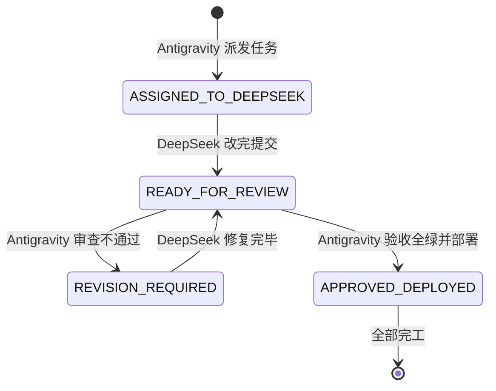

# FamilySoul · 双 AI 协作信箱总线 (COLLAB_BUS)

> **使用说明**：
> - **Antigravity（本端）**：负责方案架构设计、代码深度复审、回归测试把关、打包与生产部署；
> - **DeepSeek（对端）**：负责依据任务单落实代码编写、重构与基础自测；
> - **相公（用户）**：**彻底告别搬砖复制长文**，只需在两端窗口分别发送一两字指令即可！

---

## 📌 当前信箱状态

```json
{
  "status": "READY_FOR_REVIEW",
  "last_updated": "2026-11-05 17:47",
  "active_task": "招募弹窗：安家银价格与提示修正",
  "changed_files": [
    "mobile/lib/views/army_sheet.dart"
  ],
  "android_apk": "Desktop_Updated_17:47",
  "regression_tests": "20/20 PASSED",
  "flutter_analyze": "0 issues",
  "server_side": "无改动（客户端无需重装其它内容）",
  "reviewer_action": "请审查信箱"
}
```

---

## 🚦 状态机流转规则



1. **`ASSIGNED_TO_DEEPSEEK`**：Antigravity 已在信箱下方写好需求与代码修改清单。
   👉 **相公只需对 DeepSeek 发送**：*“去读 docs/COLLAB_BUS.md 执行任务，改完把状态改成 READY_FOR_REVIEW”*。
2. **`READY_FOR_REVIEW`**：DeepSeek 改完代码，并在信箱下方写好完成报告。
   👉 **相公只需对 Antigravity 发送**：*“审查信箱”*。
3. **`REVISION_REQUIRED`**：Antigravity 查出 Bug，写回修改意见，状态变更为需修改。
   👉 **相公只需对 DeepSeek 发送**：*“信箱里有修改意见，去改完并切回 READY_FOR_REVIEW”*。
4. **`APPROVED_DEPLOYED`**：Antigravity 确认 20/20 全绿，自动打包更新软路由，本次任务圆满结束。

---

## 📋 本轮任务与完成报告（2026-11-05 17:47 · READY_FOR_REVIEW）

### 任务：招募弹窗的安家银价格与提示

### 病灶

招募弹窗（家兵面板 → 招募家丁 / 招募护院）显示的是旧价格：

```
家丁：1 两 / 人        ← 实际服务端是 0.2 两安家银 + 0.6 两/月
护院：3 两 / 人        ← 实际服务端是 0.5 两安家银 + 0.9 两/月
"共 N 两" 也按错误单价算
```

而且弹窗只写「X 两 / 人」，没有说明"这是安家银、月饷另算"，也没提"一呼百应、来投人数不定"。

### 改法（只改客户端展示层，服务端价格未动）

| 位置 | 改动 |
|---|---|
| 按钮文案 | `招募家丁 ·安家0.2两` / `招募护院 ·安家0.5两` |
| 弹层价格 | `安家银 0.20 两 / 人`（按 double 显示两位小数） |
| 弹层新增 | `月饷 0.60 两 / 人 / 月（每月初一放饷）` |
| 弹层新增说明 | 家丁：「一呼百应：来投多少看你的名声与这座城的日子，喊 50 人未必来 50 个。」<br>护院：「护院是精壮武师，安家银比家丁贵些，月饷 0.9 两；一样是看名声与民心来人。」 |
| 合计 | `共 6.00 两`（30 人 × 0.2，此前会算成 30 两） |
| 结果提示 | 由"招募家丁 30人"改为 **「一呼百应：喊 30 人，来投 4 人（月饷 X 两/月）」**，报实际来投人数 |

### 验证

```
flutter analyze       0 issues
python scripts/regress.py   20/20 PASSED
安卓包                 已重打并覆盖桌面（17:47）
服务端                 无改动
```

### 说明

- **价格本身没有改**：0.2 / 0.5 安家银、0.6 / 0.9 月饷，是上一轮按史料定的，服务端 `RECRUIT_KINDS` 里的真值。
  本轮只把客户端显示改对，并补上"月饷/一呼百应"的说明。
- **顺带修了提示语误导**：以前无论来几个人都提示"招募 N 人"，现在报"喊 N 人，来投 M 人"。

---

## 📋 历史交付记录汇总

### ✅ 已验收上线任务（2026-11-05 17:30）
- **任务一（客户端操作闭环）**：家兵面板挂匪寨与出征；我的世界挂中馈月例与补发；出门抽屉挂商货行栈。
- **任务二（市井呼应）**：匪患 2 阶以上客商求庇；聊天 `[[quell:名|人数]]` 触发剿匪并出战后报。
- **任务三（架构提纯）**：`visiblePropertiesOf` 单一出处，消除 `/api/me` 与 `/api/world/menu` 重复。
- **当前状态**：全量回归 20/20；软路由已热更新；安卓包已覆盖桌面。
