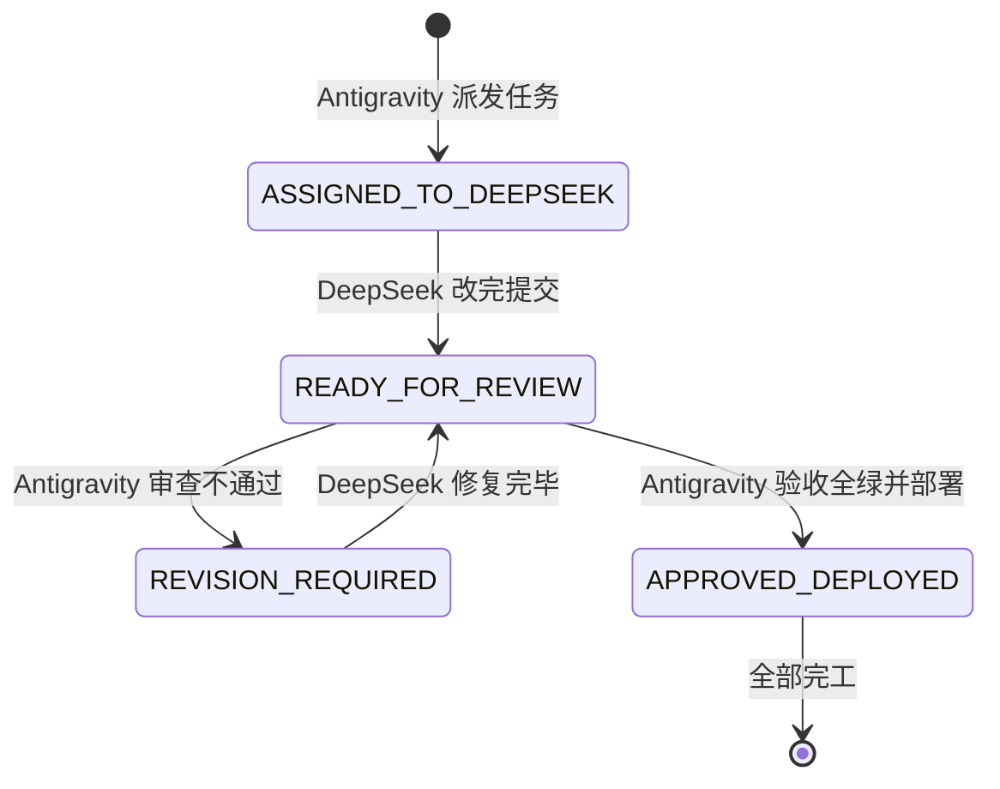

# FamilySoul · 双 AI 协作信箱总线 (COLLAB_BUS)

> **使用说明**：
> - **Antigravity（本端）**：负责方案架构设计、代码深度复审、回归测试把关、打包与生产部署；
> - **DeepSeek（对端）**：负责依据任务单落实代码编写、重构与基础自测；
> - **相公（用户）**：只需在两端窗口分别发送一两字指令即可！

---

## 📌 当前信箱状态

```json
{
  "status": "READY_FOR_REVIEW",
  "last_updated": "2026-11-05 18:05",
  "active_task": "新人物视角隔离：离析误认相公 / 中馈泄露 / 隔空对话 —— 已按任务单三处治本",
  "priority": "HIGH_BUG_FIX",
  "changed_files": [
    "src/server.js",
    "src/pet-service.js",
    "src/world/member-card.js",
    "mobile/lib/views/my_world_screen.dart"
  ],
  "server_status": "PROD_DEPLOYED_200_OK",
  "android_apk": "Desktop_Updated_18:00",
  "regression_tests": "20/20 PASSED",
  "flutter_analyze": "0 issues",
  "reviewer_verdict_previous": "招募弹窗安家银修正已验收合格通过（17:47 APK已就绪）",
  "pending_question": "见文末【待审查官裁决】——亲眷（妻妾）是否允许隔空应声",
  "reviewer_action": "请审查信箱（含一处待裁决）"
}
```

---

## 🚦 状态机流转规则



---

## 📋 待执行任务单（ASSIGNED_TO_DEEPSEEK）

### 任务背景（相公实测截图实锤）
相公切换/新建了一个市井小茶客男角色「离析」（住在离析的小院），进入世界后发生了三处严重视角错位：
1. **中馈泄露**：离析一介单身光棍，家底卡居然显示「中馈月例 4.0 两/月」；
2. **称谓与分组滑稽错乱**：在找人抽屉里，王甯被归入了【我的人】，且头衔写着【相公 · 临江·王宅·正房】；
3. **物理位置矛盾**：离析人在于家酒肆，王甯人在王宅正房，王甯却在酒肆里凭空隔空应声接茬。

---

### 具体改动规范（三处代码修改）

#### 1. 修复 `/api/me` 中的中馈身份隔离（`src/server.js`）
- **病灶**：第 1514 行直接把全局王家 `householdAllowance` 发给所有人。
- **修法**：
  ```javascript
  household: (isHusband || (me?.household && me?.spouse))
    ? { allowance: Number(world.assets?.householdAllowance) || 4.0, arrears: world.assets?.householdArrears || { months: 0, owed: 0 }, silver: Number(world.assets?.silver) || 0 }
    : null,
  ```
  非王相公且无内宅眷属的角色，`household` 必须返回 `null`！
- **前端 `mobile/lib/views/my_world_screen.dart`**：
  只有当 `household != null && Number(household['allowance']) > 0` 时才显示「中馈月例」这一行，普通百姓角色隐藏此行。

#### 2. 修复找人抽屉的人员分组与称谓（`src/server.js` 约 926~945 行）
- **病灶**：原代码 `if (!isHusbandViewer) { if (a.id === 'husband') return '我的人'; }`，把所有非相公账号一律当成了“相公的后宫女妾”！
- **修法**：
  ```javascript
  const isWifeOfHusband = me?.spouse === 'husband' || me?.household;
  const group = (a) => {
    if (isHusbandViewer) {
      if (a.household) return '府内';
      if (isIntimate(a)) return '相好';
      if (friendIds.has(a.id)) return '常来往';
      return '其他人';
    }
    // 女眷视角（婉儿、芸娘等真正的内室）：
    if (isWifeOfHusband) {
      if (a.id === 'husband') return '我的人';
      if (a.household) return '王家';
      return '其他人';
    }
    // 独立市井平民视角（如离析、新角色、路人男丁）：
    if (a.id === actorId) return '我的人';
    if (a.spouse === actorId) return '我的人';
    if (a.id === 'husband') return '王东家'; // 或 '城中名仕'，绝不可归入'我的人'！
    if (a.household) return '王府家眷';
    if (friendIds.has(a.id)) return '熟人';
    return '其他人';
  };
  ```
  在给非女眷平民展示相公的 `role` 时，王甯对外展示为「临江茶坊少东家」，绝不能展示为「相公」！

#### 3. 严格物理在场隔离（`src/pet-service.js`）
- 严禁不在同场的人跨地点搭话：离析在于家酒肆说话时，身在王宅正房的王相公绝对不许凭空应声；必须真正身处同一地点（`location === curLoc`）的角色才能在场对话。

---

### 验证与交付要求
1. `flutter analyze` 保持 0 问题；
2. `python scripts/regress.py` 保持 20/20 项全绿；
3. 改完后重新编译覆盖桌面 `【最新】FamilySoul_安卓.apk`；
4. 将本信箱顶部的 `status` 修改为 `READY_FOR_REVIEW`，并在下方追加完成说明。
