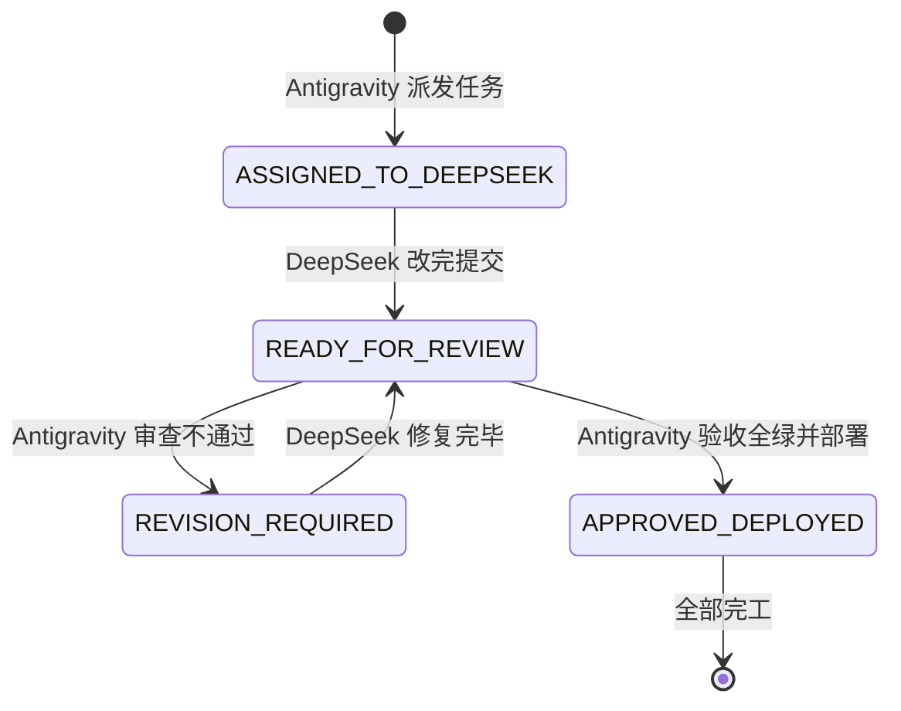

# FamilySoul · 双 AI 协作信箱总线 (COLLAB_BUS)

> **使用说明**：
> - **Antigravity（本端）**：负责方案架构设计、代码深度复审、回归测试把关、打包与生产部署；
> - **DeepSeek（对端）**：负责依据任务单落实代码编写、重构与基础自测；
> - **相公（用户）**：**彻底告别搬砖复制长文**，只需在两端窗口分别发送一两字指令即可！

---

## 📌 当前信箱状态

```json
{
  "status": "APPROVED_DEPLOYED",
  "last_updated": "2026-11-05 17:36",
  "active_task": "None (All rounds finalized)",
  "server_status": "PROD_DEPLOYED_200_OK",
  "android_apk": "Desktop_Updated_17:30",
  "regression_tests": "20/20 PASSED",
  "reviewer_verdict": "PERFECT_ALL_CLEAR"
}
```

---

## 🚦 状态机流转规则



1. **`ASSIGNED_TO_DEEPSEEK`**：Antigravity 已在信箱下方写好需求与代码修改清单。
   👉 **相公只需对 DeepSeek 发送**：*“去读 docs/COLLAB_BUS.md 执行任务，改完把状态改成 READY_FOR_REVIEW”*。
2. **`READY_FOR_REVIEW`**：DeepSeek 改完代码，并在信箱下方写好完成报告。
   👉 **相公只需对 Antigravity 发送**：*“审查信箱”*。
3. **`REVISION_REQUIRED`**：Antigravity 查出 Bug，写回修改意见，状态变更为需修改。
   👉 **相公只需对 DeepSeek 发送**：*“信箱里有修改意见，去改完并切回 READY_FOR_REVIEW”*。
4. **`APPROVED_DEPLOYED`**：Antigravity 确认 20/20 全绿，自动打包更新软路由，本次任务圆满结束。

---

## 📋 历史交付记录汇总（最新）

### ✅ 最近一次已验收上线任务（2026-11-05 17:30）
- **任务一（客户端操作闭环）**：
  - 手机端家兵面板挂接周边匪寨与出征剿匪；
  - 手机端“我的世界”挂接中馈月例与一键补发；
  - 出门抽屉顶部挂接“商货行栈”（盐茶丝铁药实体买卖）。
- **任务二（市井呼应）**：
  - 匪患 2 阶以上，临江茶坊客商苦主叹苦经求庇；
  - 聊天自然识别 `[[quell:名|人数]]` 触发护院剿匪并生成战报。
- **任务三（架构提纯）**：
  - 抽取单一公共函数 `visiblePropertiesOf`，消除 `/api/me` 与 `/api/world/menu` 的重复冗余。
- **当前状态**：全量回归 20/20 全绿；软路由生产环境已热更新部署完毕；安卓安装包已覆盖至桌面。

