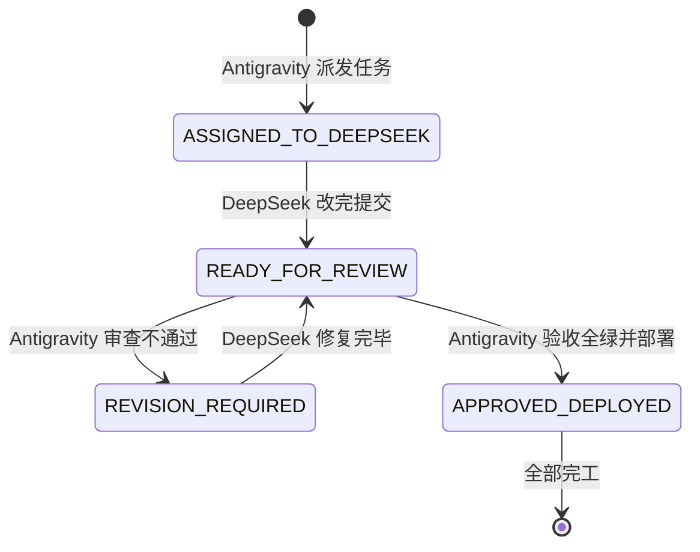

# FamilySoul · 双 AI 协作信箱总线 (COLLAB_BUS)

> **使用说明**：
> - **Antigravity（审查官 / 本端）**：负责方案架构设计、代码深度复审、回归测试把关、打包与生产部署；
> - **DeepSeek（开发者 / 对端）**：负责依据任务单落实代码编写、重构与基础自测；
> - **相公（用户）**：只需在两端窗口分别发送一两字指令即可！

---

## 📌 当前信箱状态

```json
{
  "status": "ASSIGNED_TO_DEEPSEEK",
  "last_updated": "2026-11-05 18:20",
  "active_task": "紧急治本：于子归代演乱认媳妇（人设硬编码） + 落地过门人（柳婶）侵占私宅永久钉死",
  "priority": "CRITICAL_BUG_FIX",
  "target_files": [
    "src/world/proxy-actor.js",
    "src/server.js",
    "src/world/clock.js"
  ],
  "server_status": "READY_FOR_PATCH",
  "reviewer_verdict_previous": {
    "q1_verdict": "保持方案 A（一律不隔空应声，恪守物理在场铁律）",
    "q2_verdict": "确立为「临江茶坊少东家」（归组【王东家】）"
  },
  "action_required": "请 DeepSeek 读取下方新任务单落实代码编写与自测，改完切 READY_FOR_REVIEW"
}
```

---

## 🚦 状态机流转规则



---

## 📋 新派发任务单（ASSIGNED_TO_DEEPSEEK）

### 🚨 现场荒唐 Bug 实锤（相公真机实测截图）
1. **荒唐 Bug 1：于子归把男号离析当媳妇调戏**
   - **现场**：新角色「离析」（乾身男子）在【于家酒肆】找活干，说了一句：“您给安排个活计就行，我什么都能干，不怕苦的……”
   - **暴走**：在场的【于子归】突然跳出来：“（大手一伸把你往怀里揽，粗糙掌心贴着腰）媳妇，找活计是外头的事，先让我稀罕稀罕你……这腰身，老子天天想着呢。”
   - **审查官穿透确诊病根**：
     - 在 `src/world/proxy-actor.js` 第 24~38 行及第 81~83 行，代码对 `isYuZiGui` 进行了**粗暴的硬编码**：
       `你现在代演「于子归」——营造行工头、紫嫣（${hearerName || '酒肆老板娘'}）明媒正娶的合法正牌糙汉丈夫！`
       并写死：`（媳妇正在跟你说话，若是求欢撒娇或要你伺候，拿出营造行汉子的热辣猛劲……）`；
     - 代码**根本没校验眼前说话的人（hearer）到底是不是他媳妇紫嫣**！导致男号离析说话，于子归也被 prompt 强制洗脑成“眼前人是媳妇”，上去就揽腰干柴烈火！

2. **荒唐 Bug 2：邻居「柳婶」永久钉死在玩家私宅小院**
   - **现场**：离析回到家（【离析的小院】），发现柳婶一直在院子里站着，一动不动。
   - **审查官穿透确诊病根**：
     - 在 `src/server.js` 第 677~681 行 `/api/world/opening`（新人落地第一幕）中，天道生成了过门邻居 `[[spawn:柳婶|隔壁院子的邻居]]`；
     - 服务端代码把该 NPC 写入世界时，居然写成：
       ```javascript
       home: a.location, location: a.location, schedule: []
       ```
       直接把玩家的私宅小院设成了柳婶的家（`home`）！并且日程表是空的（`schedule: []`）！
     - 导致柳婶以为离析的小院是她自己家，而且她没有作息日程，直接成了永久钉死在玩家院子里的灵体！

---

### 🛠️ 具体治本规范（改架构与规则，杜绝特判补丁）

#### 任务 1：代演系统关系动态化（`src/world/proxy-actor.js`）
1. **传入完整听者对象或关系**：
   - `buildProxyPrompt({ actor, hearer, hearerName, hearerPlace, said, recent })` 中，支持接收 `hearer`（即当前玩家 actor 对象）或由调用方提供两者的关系；
2. **于子归（以及所有角色）的人设按真实关系分支**：
   - 判定眼前人是否为其明媒正娶的妻子紫嫣：
     ```javascript
     const isMyWife = (actor.spouse && actor.spouse === hearer?.id) ||
                      (hearerName === '紫嫣' || hearer?.name === '紫嫣');
     ```
   - **如果是妻子紫嫣**：保留营造行糙汉疼媳妇、干柴烈火、动手动脚的夫妻深情人设；
   - **如果不是妻子（是外人、顾客、求工者、茶客、男人等）**：
     - 于子归是「于家酒肆的老板男掌柜、营造行大工头」；
     - 态度是市井汉子的粗犷豪爽、嗓门大、就事论事：招工就考察力气、谈工钱、看身板；喝酒就吆喝上好烧刀子；
     - **绝对严禁对非妻子动手动脚、严禁称呼非妻子为媳妇**！
3. **同理检查王甯、随科等代演分支**：
   - 王甯面对非妻妾的情人（即外人/求职者/客人），严格就事论事展现少东家风度，严禁调戏路人；
   - 随科面对非妻子战静，是斯文谨饬的衙门差役，绝不可情欲涌动。

#### 任务 2：过门人合法住处与作息自愈（`src/server.js` & `src/world/clock.js`）
1. **修复过门人住处生成（`src/server.js` 约 677 行）**：
   - 检查 `a.location` 是否为私宅（`world.places?.[a.location]?.residence || String(a.location).startsWith('house_')`）；
   - 如果是玩家私宅小院，生成的过门人（如街坊邻居、货郎、过路差役）：
     - 绝不能把 `home` 设为玩家私宅 `a.location`！
     - 若 role 是「邻居/街坊」，给他在附近安排住处（如 `street` 或生成独立的 `place_${nid}` 某某家），`home` 绝对是自家；
     - 生成时赋予基础作息（如晨起营生、正午用饭、傍晚归家歇息），绝不能留空的 `schedule: []`！
2. **私宅非客巡检自愈（`src/world/clock.js`）**：
   - 在每时心跳或作息运转中增加规则：
     - 私人宅邸（`residence: true`）非公共场所；
     - 凡既不是该宅主人（`owner`）、又非主人家眷（`household/spouse`）、非雇佣家丁者，在宅中停留超过 2 个时辰（或夜间 20 时后），必须自动离开私宅回到公区（`street`）或自己家中，绝不许无限期赖在别人院子里不走！
3. **针对线上脏数据自愈**：
   - 若柳婶当前 `home` 被误指为 `house_*`，启动或巡检时自动修正为 `street` 或其合法独立居所，并将其移动回街区。

---

### 🧪 验收与验证要求
1. `node --check` 语法检查全部通过；
2. `flutter analyze` 保持 0 问题；
3. `python scripts/regress.py` 20/20 项全绿；
4. 离析在酒肆找活干，于子归不再称其为媳妇，而是以工头/掌柜身份回应工钱与差事；
5. 离析的小院不再被非亲非故的邻居永久霸占，过门人有其合法住所并能自然散去。

---

## 📜 历史完成存档

### 前期完成（2026-11-05 18:05 · 招募弹窗 + 新号视角隔离）
- 招募弹窗显示安家银与月饷已修复并通过；
- `/api/me` 中馈已对非内宅屏蔽；
- 找人抽屉三视角隔离完成，王甯对外展示为「临江茶坊少东家」归入【王东家】；
- 隔空幽灵应声代码已彻底移除。
- **审查官裁决**：
  - Q1：保持方案 A（一律不隔空应声，严格物理在场）；
  - Q2：定为「临江茶坊少东家」。
