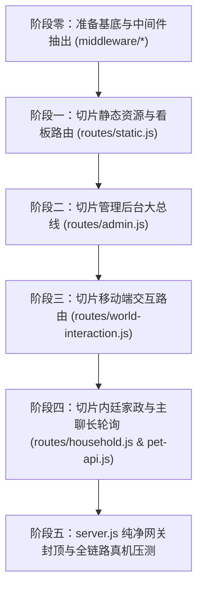

# FamilySoul · 服务端核心（server.js）架构解耦与分层重构白皮书

> **【重构指导思想】**  
> 1. **零破坏与渐进式重构**：绝不搞大爆炸式休克重写，按功能域分块切片，每拆一块必须本地全量回归测试（`python scripts/regress.py` 20/20）全绿才推进下一块；
> 2. **发现问题就地根治**：在解耦过程中，凡发现硬编码、死锁逻辑、历史临时补丁，严禁机械原样搬迁，必须按单一真相源治根重构后再纳管；
> 3. **极简网关原则（KISS）**：重构完成后，`src/server.js` 仅保留服务初始化、中间件装配与路由顶层挂载，总代码量严格控制在 **300 行以内**！

---

## 一、现状解剖：为什么 `server.js` 变成了 6250 行超级大泥球？

当前 `src/server.js` 承担了至少 6 个不相干的系统职责，代码高度耦合：

| 职责模块 | 当前大致行数 | 承担功能与涉及接口 | 痛点与隐患 |
| :--- | :--- | :--- | :--- |
| **网关与鉴权底座** | ~400 行 | HTTP 监听、CORS、Token 鉴权、路由正则匹配 | 混杂在几千行业务中，入口极不清晰 |
| **移动端交互核心** | ~1500 行 | `/api/world/go`, `/summon`, `/confirm`, `/menu` | 交互抽屉的核心逻辑，涉及位移、迎候、付款 |
| **通信与长轮询总线** | ~1200 行 | `/pet-api/chat`, `/events`, `/history`, `/audio` | 聊天主链路与世界主动找人通道，实时性最高 |
| **运维与调试后台** | ~2200 行 | 数十个 `/api/admin/*`（查账、修剪、造匪、自更新） | 纯管理接口，却与相公高频业务挤在一个文件 |
| **家政与社会关系** | ~600 行 | `/api/world/household`, `/trade`, `/opening` | 纳妾、家规、商贸等内廷业务 |
| **静态资源与看板** | ~350 行 | `/`, `/index.html`, `/dashboard.html` 托管 | 静态文件流式输出 |

---

## 二、目标解耦分层架构（清晰模块边界）

重构后的目录结构规划在 `src/routes/` 目录下，形成标准的责任链与微路由体系：

```
src/
├── server.js                     # 🌟 纯净微网关（<300行）：端口监听、中间件、顶层路由路由分发
├── middleware/                   # 🛡️ 统一网关中间件
│   ├── cors.js                   # 跨域与基础安全头
│   ├── auth.js                   # 成员身份识别与 Token 鉴权（resolveMember）
│   └── body-parser.js            # 安全 JSON 解析与限制
└── routes/                       # 📦 领域路由模块（职责物理隔离）
    ├── world-interaction.js      # 移动端交互：/world/go, /world/summon, /world/confirm, /world/menu
    ├── pet-api.js                # 移动端长轮询与主聊：/dsh-surfcore/pet-api/*, /audio/*
    ├── admin.js                  # 管理运维总线：/api/admin/*（自更新、诊断、治愈、调账）
    ├── household.js              # 内廷家政与关系：/api/world/household, /trade, /charity
    └── static.js                 # 静态托管：web/, dashboard.html, 头像媒体流
```

---

## 三、五阶段循序渐进切片路线图



### 阶段零：网关中间件抽离（非侵入打底）
- **目标**：抽出 `src/middleware/auth.js`（`resolveMember` 等身份逻辑）、`src/middleware/body-parser.js`；
- **验收**：`node --check` 语法校验通过，`python scripts/regress.py`（20/20）全绿。

### 阶段一：抽离静态资源与看板大屏（最低风险切片）
- **抽离目标**：`routes/static.js`（处理 `/`、`/dashboard.html`、`/web/*`、`/avatars/*`）；
- **预估减负**：从 `server.js` 中减去约 350 行；
- **验收**：访问软路由 `http://192.168.1.254:3088/dashboard.html` 完美渲染，回归全绿。

### 阶段二：抽离管理运维总线 `routes/admin.js`（最大减负切片）
- **抽离目标**：将所有 `/api/admin/*` 接口（`self-update`, `world/clock`, `wallet`, `income`, `history/read`, `actor/move` 等）完整搬移至 `routes/admin.js`；
- **历史旧病清查点**：
  - 清理调试期遗留的历史死路由与临时测试特判；
  - 统一错误返回格式 `{ ok: false, error: ... }`；
- **预估减负**：从 `server.js` 中减去约 **2200 行**代码；
- **验收**：调用 `/api/admin/world`、自更新等接口无缝响应，回归测试（20/20）全绿。

### 阶段三：抽离移动端交互核心 `routes/world-interaction.js`（核心体验切片）
- **抽离目标**：将 `/api/world/go`、`/api/world/summon`、`/api/world/confirm`、`/api/world/menu`、`/api/world/who` 抽出；
- **历史旧病清查点**：
  - 检查王宅内室归属、雅间直达等判定规则是否整洁；
  - 校验迎候打招呼与历史落盘逻辑是否完全单一入口；
- **预估减负**：从 `server.js` 中减去约 **1500 行**代码；
- **验收**：手机端点击去哪儿、叫人来、回王宅正房、大酒楼雅间，迎候与位置 100% 正常。

### 阶段四：抽离长轮询、主聊与内廷家规 `routes/pet-api.js` & `household.js`
- **抽离目标**：`/dsh-surfcore/pet-api/*`（events、chat、history、clear）、`/audio/*`、`/api/world/household`；
- **预估减负**：从 `server.js` 中减去约 **1800 行**代码；
- **验收**：手机端视讯、语音播放、打字聊天、主动事件轮询秒级响应，回归测试全绿。

### 阶段五：`server.js` 纯净网关封顶
- **收尾目标**：`server.js` 仅保留 `http.createServer`、全局异常捕获与上述 5 大路由分发器，行数压制在 **250~300 行**；
- **打包部署**：本地生成新版更新包，推送到软路由生产机热更新，完成全链路闭环。

---

## 四、代码重构中的【防退化守卫军规】

1. **路由签名契约零改变**：
   路由向子模块拆分时，签名统一约定为：
   ```javascript
   export async function handleWorldRoutes(req, res, { url, pathname, world, member, dataDir, config }) {
     // 若本模块处理了请求返回 true，否则返回 false 让下一层路由匹配
   }
   ```
   严禁私自改动 URL 路径、请求参数名与 HTTP 状态码，保障移动端 App 零感知、零受害。
2. **改一块、测一块、留一份存档**：
   每个切片阶段完成后，必须先跑：
   - `python scripts/regress.py`（20 项回归测试）
   - `node scripts/test_dialogue_sanitizer.mjs`
   测试全部通过才允许进入下一个切片！
3. **遇到坏代码当场治理**：
   在搬运路由代码时，如果发现有变量重复命名、冗余 try-catch 吞报错、或者怪异特判，立即在模块内重构成规范的干净逻辑，绝不把垃圾代码搬家！

---

## 五、实战血泪经验教训与双重防漏铁网（2026-11-10 记入小本本）

### 1. 痛点复盘：为什么切片 2000 行会漏？
- **隐式闭包偷变量**：原 `server.js` 6300 行共享顶层作用域，被切走的接口随手偷用了外层的局部函数（如 `matchRoute`）或常量（如 `HUMAN_ONLINE_MS`）；
- **`node --check` 的欺骗性**：它只检查 SyntaxError（括号分号），**绝不做作用域引用检查**；哪怕引用了不存在的变量，只要语法合法就会绿灯放行，直到运行时踩中分支才报 `ReferenceError`；
- **盲区**：剧情回归测试 `regress.py` 覆盖了核心叙事与推演军规，但没有对每个管理后台 GET/POST 路由做真实 HTTP 冒烟覆盖。

### 2. 明日接手强制执行的【双重防漏铁网】
1. **静态扫描铁网**：
   - 每次抽离代码到新模块后，**必须运行 AST 作用域检查**（检查所有自由变量 Free Variables），凡是既未 import、又未在本地声明、也不是标准 globalThis 的，打包前直接拦截报警；
2. **端点冒烟铁网（Smoke Test）**：
   - 编写 `scripts/smoke_test_endpoints.mjs`，解耦后在本地启动服务，全自动向所有抽离的接口发送探测请求；
   - 必须确保 `/dashboard`、`/api/admin/world`、`/api/admin/perf` 等关键端点在本地全部吐出 HTTP 200，方可打包推送。

---

*最新状态：阶段零、阶段一、阶段二已完成，`src/server.js` 从 6298 行降至 4030 行（单次瘦身 2268 行，变动删除 2782 行）。阶段三（移动端交互 /world/go 等）明日继续。*


