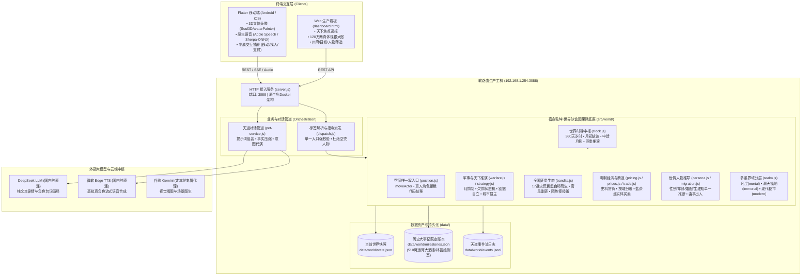
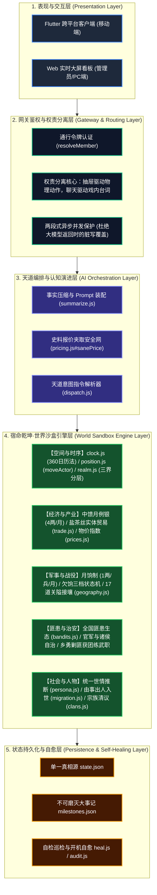
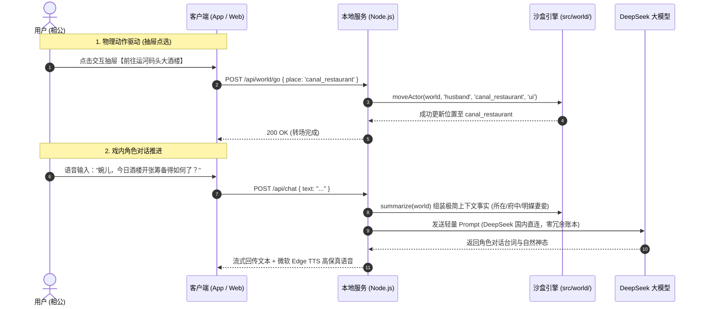

# FamilySoul（宿命乾坤）· 全景系统架构白皮书

> **文档版本**：v2.0（全域沙盒自洽运行版）  
> **更新时间**：2026-11-05  
> **最高设计原则**：**代码算账，LLM只演戏；单一写入口；有病治根，彻底禁止打补丁**。

---

## 一、系统全景拓扑图（部署与通信架构）



---

## 二、软件分层架构解析（从上至下）



---

## 三、系统核心设计铁律与状态单一流向

| 核心领域 | 单一写入口函数 / 模块 | 核心规则与闭环保证 |
|---|---|---|
| **人物移动** | `src/world/position.js` ➔ `moveActor()` | • 真人角色（相公）世界代码移动一律拒绝，仅认客户端抽屉调用；<br/>• 杜绝“说回家就位移”等文字偷听；在押罪犯锁死牢狱。 |
| **城池产权** | `src/world/warfare.js` ➔ `changeCityOwner()` | • 城市归属变动唯一入口；旧主领地剔除、新主补入、驻军产权联动转移。 |
| **军事与兵饷** | `src/world/warfare.js` ➔ `runPayday()` / `callToArms()` | • 告别超市买断，招募走“一呼百应”付微量安家银；<br/>• 日常只按 0.02 石扣粮，每月初一统发月饷（1两/兵/月）；<br/>• 欠饷分级：1月怨声、2月逃兵当兵器、3月全营哗变并三成反噬洗劫府库。 |
| **小家中馈** | `src/world/clock.js` ➔ `runHouseholdPayday()` | • 天道每月初一从公中划拨 4 两白银给主母沈婉儿操持内宅；<br/>• 欠银触发典当危机（1月典钗贴补、2月炭火减半、3月内宅生计维艰）。 |
| **人物世情** | `src/world/persona.js` ➔ 三大 `infer` 函数 | • 性别、岁数、婚配按姓名与行当分类归纳推算，杜绝 `unknown`；<br/>• 生理周期严格限定在 14~49 岁，50岁以上归为长者绝经。 |
| **全国匪患** | `src/world/bandits.js` ➔ `runBanditEcosystem()` | • 全天下 17 道根据民怨（`unrest≥50`）、灾荒与地形自然涌现；<br/>• 官军自发剿匪；相公派护院剿匪保境安民，获缴获与知府团练使任命。 |
| **世界分层** | `src/world/realm.js` ➔ `buildRealm()` / `realmOf()` | • 凡尘（`mortal`）、洞天（`immortal`）、现代（`modern`）多界共存；<br/>• 人在何界由地点属性决定，通过门户（`gate`）跨界跃迁。 |

---

## 四、天道（LLM）与本地代码引擎的权责边界



> **边界原则总结**：
> - **引擎做算力与真理**：银两、粮食、兵数、城防、伤亡、物价、年龄、生理周期，**100% 由本地引擎毫秒级精确计算，0 Token 浪费**；
> - **天道做灵魂与对白**：大模型仅在需要推进剧情、沉浸对话、描写场景时登场，只负责“说合乎身份的漂亮人话”，绝不让大模型做算术题！

---

## 五、环境事实与生产规范

1. **主力生产主机**：
   - 软路由生产环境唯一确定为：**`/opt/familysoul`（监听端口 3088）**；
   - 严禁任何 AI 质疑软路由路径或建议拷贝至历史废弃的 `/opt/surfcore-server`；
2. **官方热更新发布指令**：
   ```bash
   node scripts/build-update.mjs && python scripts/self_update.py
   ```
3. **打包资产安全准则**：
   - `update.tar.gz` 必须包含 `data/world/milestones.json`（保障 510 两运河大酒楼等既定事实不沉没）；
   - 仅排除生产端自维持的运行时文件（`data/chat`、`data/world/state.json`、`data/world/events.jsonl`）。

