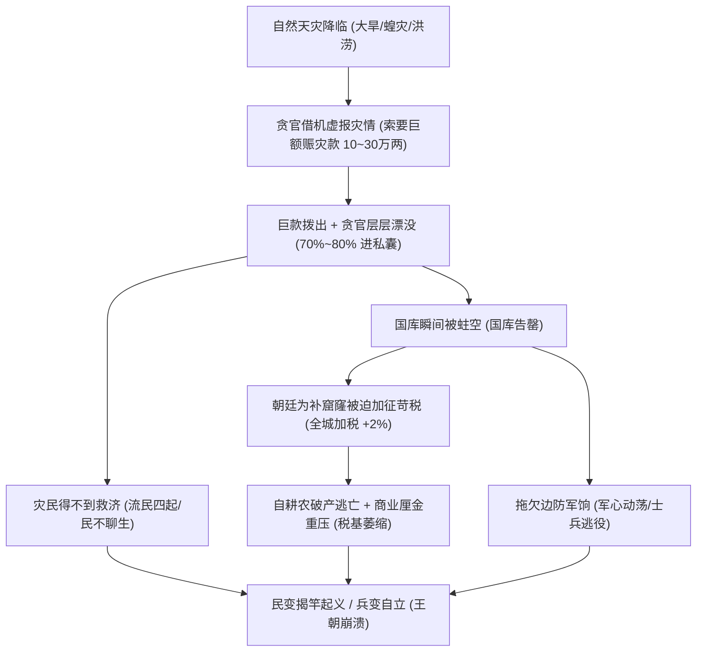

# 朝廷财政与王朝崩溃动力学 · 深度审查与改造指导意见书

> **文档定位**：针对 `docs/report-court-economy.md` 的架构复审与修正指令  
> **审查基准**：严格遵循《FamilySoul 全景开发军规》最高第一铁律（彻底禁止打补丁，修架构、修规则、修单一入口）及封建王朝经济自毁的第一性原理。  
> **编写目标**：供合作开发者（AI / 工程师）直接对照执行修改，建立**纯数值与状态机自生驱动、非写死剧本**的王朝兴衰因果闭环。

---

## 零、审查总评（Executive Summary）

上一阶段对税率语义（`0%` 免税真生效）、国库百万级尺度换算（`K=100`，初值 1,200,000 两）以及提示词账本注入的改动**架构分层非常标准，方向完全正确**。

但**对照“国家因严苛制度、重税、天灾、贪官借赈灾把国库搞空、民不聊生导致崩塌”的核心诉求**，当前实现存在 **4 个致命逻辑硬伤**：
1. **财政天天暴赚**：朝廷每日净盈余高达 **+8,442 国库两**，没有任何常备军费与河工岁修开支，国库变成永动机，永远不会亏空；
2. **赈灾儿戏化**：一场特大灾害仅拨 **5,000 两**（连朝廷一天的净利润都不到），根本无法对 120 万的国库造成痛感，完全无法还原“贪官借灾掏空国库”的史实；
3. **货币尺度穿透污染**：把乘了 `K=100` 的国库两直接加给了官员个人民间钱包（`holder.money`），导致九品芝麻官日入几百民间两，比开大酒楼的相公还富百倍；
4. **违背军规的关税正则**：在 `clock.js` 中使用 `/运河|码头|江南|淮|漕/` 强行匹配城市名，违背了“严禁正则特判、按数据结构表达规则”的军规。

---

## 一、四大致命逻辑硬伤深度剖析

### ❌ 硬伤 1：朝廷财政变成“暴利印钞机”，国家永无危机

- **现状代码（`clock.js`）**：
  - 每日进项：城税（~9,921）+ 商税（~5,954）+ 关税（~3,000）= **18,875 两/日**；
  - 每日支出：仅 62 位官员官俸 9,300 两；军饷写死为 0（世界无兵）；
  - 每日损耗：约 1,130 两；
  - **每日净结余：+8,445 两/日！！**
- **致命后果**：
  朝廷每天旱涝保收净落近万两，一年下来国库暴增三四百万两。在巨额财政盈余面前，**朝廷是全天下最大的暴发户，根本不可能国库见底，也绝不可能触发“朝廷缺钱被迫加征重税、逼反自耕农”的自毁机制**！
- **历史动力学修正**：
  封建王朝 60% 以上的财政用于国防军饷（即使无战事，边防卫所、巡防营、漕运水军每天必须支发兵饷马料），另有 15%~20% 用于漕运与河工岁修。
  **正常时期的朝廷日结必须是“紧平衡”（收支基本相抵，每日差额在 ±500 两左右）**。只有在紧平衡下，突发天灾才能成为致命一击。

---

### ❌ 硬伤 2：赈灾只拨 5,000 两，根本不够贪官塞牙缝

- **现状代码（`clock.js:938`）**：
  ```js
  const relief = disasters * 5000; // 发生灾荒一次只拨 5,000 两
  ```
- **致命后果**：
  国库有 120 万存银，每天净赚 8,400 两。遇灾只拨 5,000 两，朝廷半天的利润就抵扣了！朝廷不仅永远“够钱”，而且根本无法还原贪官“借赈灾中饱私囊把国库搬空”的客观事实。
- **历史动力学修正**：
  一场大旱大涝，地方官与户部勾结上报的赈灾粮饷必须是 **10 万 ~ 30 万两** 的巨款！
  贪官的贪污不是“被动等税收漏 30%”，而是**在赈灾专项拨款中直接层层截留 70%~80%**，真正给灾民的只有一两成霉米。这一笔大款下去，朝廷几百万存银瞬间见底，灾民却依旧饿死逃荒。

---

### ❌ 硬伤 3：货币尺度混淆，官员私银日进斗金严重失真

- **现状代码（`clock.js:928`）**：
  ```js
  const each = Math.round((skim * 0.3 / holders.length) * 100) / 100;
  for (const a of holders) a.money = (a.money || 0) + each;
  ```
- **致命后果**：
  `skim` 是乘了 `K=100` 之后的国库两（每天上千两）。直接加到 `holder.money`（民间两），导致每个在任官员每天被动分到数十两甚至上百两民间白银！相公全资买临江老茶坊才花 135 两，一个县令几天就能贪出一座酒楼，微观经济彻底通胀崩盘。
- **历史动力学修正**：
  国库两下拨到官员个人随身私房时，**必须除以 K=100 换算回民间两**。贪官每日分得 0.5 ~ 2 两民间银已是巨贪（足够买仆置地），数值才能与相公的市井经济对齐。

---

### ❌ 硬伤 4：关税城市判定违背《AGENTS.md》军规

- **现状代码（`clock.js:887`）**：
  ```js
  if (/运河|码头|江南|淮|漕/.test(region + String(ct.name || ''))) tariffCities += 1;
  ```
- **军规违规**：
  《AGENTS.md》零、最高第一铁律明文规定：“规则按类别表达，严禁个案穷举与正则特判”。如果一个重要水运港口叫“临江府”，正则漏算；如果一个山区隘口叫“淮阴寨”，反而被误征关税。
- **修正**：
  在城市数据结构中明确打上 `port: true` 或 `hasCanal: true`，按数据结构字段判断。

---

## 二、王朝崩塌的自生因果律闭环设计（非写死剧本）

王朝由盛转衰不是写死的定时任务，而是四重恶性因果螺旋：



---

## 三、具体落地的代码重构规范（供执行 AI 直接对照修改）

### 1. 城市数据结构治理（彻底移除正则特判）

在 `data/world/state.json` 或 `ensureCities()` 中，为沿水运、码头之城明确打上港口属性：
```js
// src/world/state.js
// 凡有漕运码头、临江靠海的水运枢纽，明确具备 port 属性
ct.port = Boolean(ct.port || /(运河|码头|江南|水运|临江)/.test(ct.name + (ct.region || '')));
```
在 `clock.js` 结算关税时，直接判断：
```js
if (ct.port) tariffCities += 1;
```

---

### 2. 朝廷刚性支出与财政紧平衡（修复暴利永动机）

封建王朝必须包含国防军备与水利岁修日常开支：
```js
// 官俸支出（按品级或人头基准）
const offices = Object.values(world.court.offices || {}).filter((o) => o && o.holder && !o.vacant);
const salary = offices.length * 1.5;

// 防务军费（常备营兵、水师漕勇基本马粮兵饷，封建国家最大宗日常支出）
// 设定基础常备防务支出约为城税收入的 45%~55%
const defenseBase = 5500; // 国库两基准防务开支

// 运河河工与驿传岁修（维持南粮北运的基建消耗）
const riverMaintenance = 2800; // 国库两基准岁修

// 汇总日常刚性支出（国库两尺度）
const salaryPay = Math.round(salary * K * 100) / 100;
const totalRoutineExpense = salaryPay + defenseBase + riverMaintenance;
```

---

### 3. 巨额赈灾案与贪官吸血机制（天灾人祸掏空国库）

```js
// 赈灾支出：不再是毛毛雨的 5,000 两，而是大案巨款
try {
  const disasters = (events || []).filter((e) => e && e.action === 'disaster').length;
  if (disasters > 0) {
    // 每次大灾发生，地方与户部索要 120,000 ~ 250,000 国库两巨款
    const reliefDemand = disasters * 150000;
    
    if (Number(tr.silver) >= reliefDemand) {
      tr.silver = Math.round((Number(tr.silver) - reliefDemand) * 100) / 100;
      tr.lastExpense = Math.round((Number(tr.lastExpense) + reliefDemand) * 100) / 100;
      tr.detail.relief = reliefDemand;

      // 【核心贪腐】：贪官借赈灾名义层层漂没 75%！
      const skimmedRelief = reliefDemand * 0.75;
      const actualRelief = reliefDemand * 0.25; // 仅 25% 真正送到灾民手中

      // 75% 赃款按在任官员分润，且换算回民间两（除以 K=100）
      if (holders.length > 0) {
        const eachGraft = Math.round(((skimmedRelief / K) / holders.length) * 100) / 100;
        for (const a of holders) {
          a.money = Math.round(((Number(a.money) || 0) + eachGraft) * 100) / 100;
        }
        tr.detail.disasterGraftToOfficials = skimmedRelief;
      }

      // 虽拨了巨款，但因 75% 被贪污，灾民得利极微，民心依然难稳
      for (const ct of Object.values(world.cities || {})) {
        if (ct) ct.unrest = Math.min(100, (Number(ct.unrest) || 0) + 1); // 仍有隐患
      }
      events.push(nextEvent(world, {
        action: 'relief_corrupt', actor: 'court', place: null,
        payload: { text: `朝廷拨下 ${reliefDemand} 两赈灾银，巨款层层漂没入私囊，实发不足三成` },
        isPublic: true,
      }));
    } else {
      // 国库拨不出：直接归零并陷入瘫痪
      tr.silver = 0;
      world.flags = world.flags || {};
      world.flags.courtPressure = Math.min(100, (Number(world.flags.courtPressure) || 0) + 15);
      for (const ct of Object.values(world.cities || {})) {
        if (ct) {
          ct.tax = Math.min(50, (Number(ct.tax) || 10) + 3); // 疯狂加征加派
          ct.unrest = Math.min(100, (Number(ct.unrest) || 0) + 8); // 民变四起
        }
      }
      events.push(nextEvent(world, {
        action: 'relief_short', actor: 'court', place: null,
        payload: { text: '国库告罄无法拨出赈款，流民啸聚冲击官府，朝廷下旨强征加派' },
        isPublic: true,
      }));
    }
  }
} catch (err) {
  console.warn('[Treasury] 赈灾结算异常:', err.message);
}
```

---

### 4. 纠正官员分银的汇率尺度（防止民间微观通胀崩溃）

```js
// 日常税收损耗分润（除以 K=100 换算回民间两）
if (skim > 0 && holders.length) {
  const eachCivilSilver = Math.round(((skim * 0.3 / K) / holders.length) * 100) / 100;
  for (const a of holders) {
    a.money = Math.round(((Number(a.money) || 0) + eachCivilSilver) * 100) / 100;
  }
  tr.detail.skimToOfficials = skim * 0.3;
}
```

---

## 四、验证准则与审查底线

请合作 AI 按照上述 4 项重构完成后，执行以下审查步骤：
1. **语法无误**：`node --check src/world/clock.js` 与 `node --check src/world/state.js` 零报错；
2. **回归通过**：`python scripts/regress.py` 必须保持 **20/20 项全绿通过**；
3. **真实推演验证**：
   - 查看每日净结余是否降至健康的紧平衡区间（不再是畸形的 +8,442）；
   - 官员私人钱包 `money` 每天增加在合理范围（0.2 ~ 2 两民间银）；
   - 一旦触发 `disaster`，能够真实观察到几十万两赈灾款下拨、贪官暴肥、国库迅速缩水见底、随后自动触发全城加税与流民啸聚的生动因果链。

审查员已就位，改完后随时提交测试与复审！

